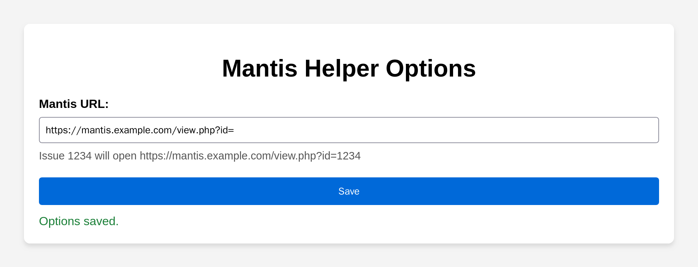
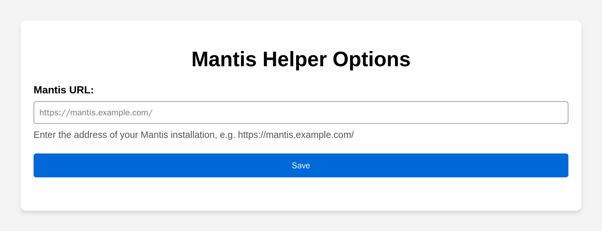
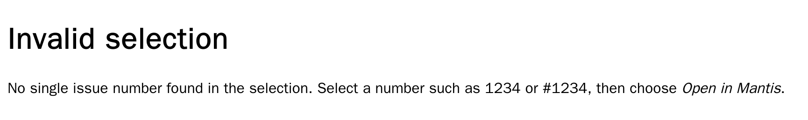

# Mantis Helper — Firefox Extension



Released: v2.1.0 on [Firefox Add-ons](https://addons.mozilla.org/firefox/addon/mantis-helper/). More screenshots: [the gallery](docs/screenshots/README.md).

## Overview
Mantis Helper is a Firefox extension that adds a context menu option for quickly opening issue numbers in [Mantis](https://www.mantisbt.org/), a popular bug tracking system. It streamlines your workflow by letting you navigate directly to Mantis issues from any webpage where an issue number is displayed.

## Features
- **Context Menu Integration:** Select an issue number on any webpage, right-click, and choose **Open “…” in Mantis**. The menu shows the selected text, and the issue opens in a new tab next to the current one, in the same container and tab group.
- **Finds the Number in the Selection:** `1234`, `#1234`, `0001234` and selections like `Issue #1234:` or `0001234: Fix login bug` all open issue 1234. If the selection contains several numbers, a `#` number wins, then a zero-padded one like Mantis displays them; otherwise the selection is ambiguous and a hint page opens.
- **Simple Configuration:** Enter the address of your Mantis installation (e.g. `https://mantis.example.com/`) and `view.php?id=` is appended automatically. Pasting a Mantis page or issue link works too, and URLs with a query string (e.g. `https://mantis.example.com/view.php?id=`) are used as they are. The options page shows which address an issue number will open.

## Permissions
The extension requires the following permissions:
- **Context Menus** — To add the "Open in Mantis" option to the browser's right-click menu.
- **Storage** — To save the Mantis URL that you set in the options.

**Data collection:** none. Mantis Helper sends nothing to its developer or anyone else. When you choose "Open in Mantis", the selected number is opened as a link on the Mantis server you configured.

## How to Use
1. **Install** the extension from [Firefox Add-ons](https://addons.mozilla.org/firefox/addon/mantis-helper/). It requires Firefox 142 or later.
2. **Configure** your Mantis URL: open the extension's options (Add-ons and themes, `about:addons` > Mantis Helper > Options) and enter the address of your Mantis installation. If you use "Open in Mantis" before configuring it, the options open automatically.

   
3. **Use it:** Highlight an issue number (e.g. `1234` or `#1234`) on a webpage, right-click, and select "Open in Mantis". If the selection holds no single issue number, a hint page opens instead:

   

To use it in private windows, allow "Run in Private Windows" for Mantis Helper in `about:addons`.

## Development
[web-ext](https://github.com/mozilla/web-ext) is a dev dependency: run `npm ci` once (Node 26, as in CI), then:
- Lint with the same validator addons.mozilla.org uses: `npm run lint` (`web-ext lint`; warnings fail it, as in CI)
- Unit tests for the selection and URL parsing in `data/mantis.js`: `npm test`
- Try it out: open `about:debugging#/runtime/this-firefox`, click "Load Temporary Add-on…" and select `manifest.json` (or run `npx web-ext run`).
- Package it for upload: `npx web-ext build` (the package is written to `web-ext-artifacts/`). The `webExt.ignoreFiles` list in `package.json` keeps the development files (`docs/`, `e2e/`, `scripts/`, `tests/`, `package*.json`) out of it.

CI (`.github/workflows/ci.yml`) runs `npm run lint`, `npm test`, the e2e suite and the screenshot tour as a render check.

## E2E
The e2e suite in [`e2e/tests/`](e2e/tests/) installs the add-on into headless Firefox as a temporary add-on (over Firefox's remote debugging protocol, as `web-ext run` does), calls the context menu's click handler with a real page's selection and tab, and checks what opens where. The options page is driven as a file with a stubbed `browser` API. [`e2e/COVERAGE.md`](e2e/COVERAGE.md) maps every feature to its test. No server, no Docker:

```bash
cd e2e && npm ci && npx playwright install --with-deps firefox && cd ..
scripts/e2e.sh                         # extra arguments go to Playwright, e.g. tests/menu.spec.ts
```

## Screenshots
The images in [`docs/screenshots/`](docs/screenshots/README.md) are taken by the docs tour in [`e2e/docs/`](e2e/docs/tour.spec.ts), in headless Firefox. Playwright cannot load an extension into Firefox, so the tour opens the pages in `data/` as files and stubs the `browser` API they use; the hint page is opened through `background.js`'s real menu handler. It needs no server and no Docker:

```bash
cd e2e && npm ci && npx playwright install --with-deps firefox && cd ..   # --with-deps: also the system libraries (sudo)
scripts/docs-screenshots.sh            # writes docs/screenshots/*.png; pass a directory to write elsewhere
```

The **Docs screenshots** workflow (manual) runs the same script and uploads the PNGs as the `docs-screenshots` artifact; it never commits.

## Changelog

### v2.1.0
Fixed:
- The options page could not be scrolled to its top when the window was lower than the form (e.g. zoomed in).
- The Save button's text and the URL field's border had too little contrast.

Changed:
- Requires Firefox 142 or later, the first version with the built-in data consent on every platform (Firefox ESR 140 reached its end of life in September 2026).

### v2.0.1
Fixed:
- The "Open in Mantis" menu entry disappeared after every Firefox restart.
- Selecting a `#`-prefixed issue number (e.g. `#123`) opened the error page.
- Values such as `1e3`, `0x1A`, `-5` or `1.5` were accepted as issue numbers.
- Unusable Mantis URLs (e.g. without `https://`) opened broken tabs; the options page now rejects them, and an unconfigured extension opens its options instead of example.com.

Changed:
- Migrated to Manifest V3; requires Firefox 140 or later.
- Declares in the manifest that no data is collected (Firefox's built-in data consent).
- The Mantis URL can be the base address of the installation; URLs without a query string are now treated as such, and `view.php?id=` is appended.
- The issue number is found within the selected text, and the menu shows the selection.
- New tabs open next to the current tab, in its container and tab group.
- The options page previews the resulting address and confirms saving inline instead of with a pop-up.

Version 2.0.0 was an unreleased build.

### v1.2.0.0
- Opens an error page when the selection is not a number.
- Removed the toolbar button.

### v1.1.0.0
- Reorganized the files, added icon sizes, README and license.

### v1.0.0.0
- Initial release (Manifest V2).

## License
See [License.md](License.md).
